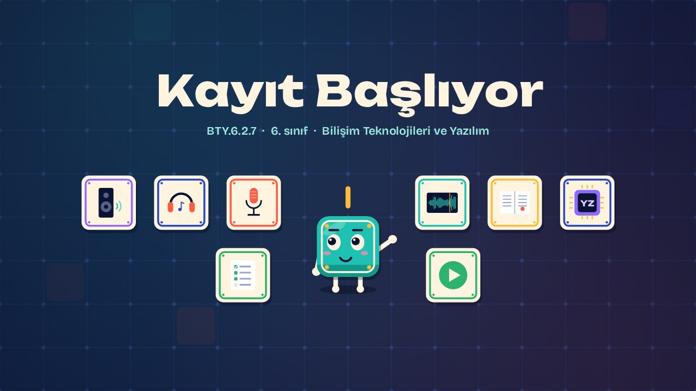
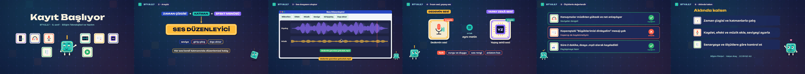

# Kayıt Başlıyor · Recording Now

**▶ Tarayıcıda izleyin / Watch in the browser:** https://hakanatas.github.io/kayit-basliyor/ 
**⬇ MP4 + altyazılar / MP4 + subtitles:** [Releases](https://github.com/hakanatas/kayit-basliyor/releases) 
**✎ Kullanılan istem / The prompt behind it:** [PROMPT.md](PROMPT.md) 
**🎞 Bütün filmler / All films:** [Bilişim Filmleri](https://hakanatas.github.io/bilisim-filmleri/?sinif=6)

> **TR —** 6. sınıf Bilişim Teknolojileri ve Yazılım dersinin "Dijital Ürün Tasarımı ve Geliştirme" temasındaki BTY.6.2.7 öğrenme çıktısı için hazırlanmış, tamamen JavaScript ile çizilen 2,0 dakikalık animasyon; ses efektleri ve hafif fon müziği de kodla üretilir. "Dedemle geçmişe yolculuk" senaryosu bir ses dosyasına dönüştürülür. Ses düzenleyicinin arayüz bileşenleri (zaman çizgisi, ses katmanları, efekt menüsü) tanıtılır. Diyalog mikrofonla kaydedilir; ses efektleri ve müzik ayrı katmanlara eklenir, ses seviyeleri ve giriş-çıkış ayarlanır, dosya dışa aktarılır. İnsan sesi ile yapay zekâ sesi vurgu, ses rengi ve anlatım hızı yönünden karşılaştırılır. Son olarak ses dosyası belirlenen ölçütlerle değerlendirilir. Altyazılar Türkçe, İngilizce ya da ikisi birlikte seçilebilir.

A 2.0-minute animation, with code-generated sound, for **6th-grade IT and Software** (Türkiye Yüzyılı Maarif Modeli). The "Trip to the past with Grandpa" script becomes an audio file: timeline, layers and effects are introduced; dialogue is recorded; effects and music go on separate layers; levels and fades are set; the file is exported; a human voice is compared with an AI voice; and the result is checked against criteria. The guide is **Karo**, a living glazed tile who never speaks: he tells the story with his face, his arms and the blinking cursor above his head.

## Öğrenme çıktısı · Learning outcome

MEB, Türkiye Yüzyılı Maarif Modeli, Bilişim Teknolojileri ve Yazılım Dersi Öğretim Programı, 6. sınıf, 2. tema "Dijital Ürün Tasarımı ve Geliştirme":

**BTY.6.2.7. Ses dosyası geliştirebilme**
- a) Tasarlanan hikâye/senaryo unsurlarından uyumlu bir ses dosyası oluşturur.
- b) Oluşturulan sesi belirlenen ölçütler açısından değerlendirir.

## Sahneler · Scenes

| # | Zaman | Sahne | Ne oluyor | Çıktı |
|---|---|---|---|---|
| 1 | 0:00–0:16 | Giriş |  |  |
| 2 | 0:16–0:45 | Arayüz | Zaman çizgisi, ses katmanları ve efekt menüsü. | a |
| 3 | 0:45–1:15 | Ses dosyasını oluştur | Kayıt, efekt, müzik katmanı, seviye, giriş-çıkış ve dışa aktarma. | a |
| 4 | 1:15–1:25 | İnsan sesi, yapay ses | İnsan sesi ile yapay zekâ sesinin vurgu, ses rengi ve hız açısından karşılaştırılması. | a, b |
| 5 | 1:25–1:47 | Ölçütlerle değerlendir | Ses dosyası belirlenen ölçütlerle değerlendirilir. | b |
| 6 | 1:47–2:02 | Aklında kalsın |  |  |

## Çalıştırma · Running it

- **Önizleme:** `index.html` dosyasına çift tıklayın (çevrim dışı da çalışır). Klavye: boşluk oynat/duraklat, ← → 3 sn, Home başa. Adrese `?altyazi=en`, `?bicim=vertical` ya da `?ses=0` eklenebilir.
- **MP4:** bir kez `npm install`, sonra `npm run export -- --format=both --captions=tr` (720p yatay ve dikey, sesli). Google Chrome yüklüyse Playwright onu kullanır (`channel: 'chrome'`); ffmpeg gerekir.
- **Altyazı ve seslendirme notları:** `npm run srt` → `out/kayit-basliyor_tr.srt`, `_en.srt`, `_tr-en.srt`, `_seslendirme-notlari.txt`.
- **Sürüm dosyaları:** `npm run release` → `release/` klasöründe v1.0'ın 6 dosyası.
- **Yazı kontrolü:** `npm run check` yatay ve dikey düzende, üç altyazı seçeneğiyle üst üste binen, kenardan taşan ya da 720p'de 17 pikselden küçük kalan yazı arar.
- **Düzenleme:** senaryo (sahneler, altyazılar, seslendirme notları) `scenes/film.js` içindedir; değiştirince `npm run build` süreleri, `captions.js` ve `film.config.js` dosyalarını yeniden üretir. Sahne şablonları `src/kit/`, Karo `src/draw/karo.js`, ses `src/audio/synth.js`.

Her kare `renderFrame(t)` ile zamanın saf fonksiyonu olarak çizilir; rastgelelik tohumludur, MP4 ekran kaydı değil kare kare üretimdir. Ses de dosyadan çalınmaz: aynı olay listesinden hesaplanır. Yazı tipleri: Unbounded ve Bricolage Grotesque (SIL OFL 1.1), dosyaya gömülü.

## Lisans · License

**TR —** Bu film ve kodu [Creative Commons Atıf-GayriTicari 4.0 Uluslararası (CC BY-NC 4.0)](https://creativecommons.org/licenses/by-nc/4.0/deed.tr) lisansıyla paylaşılır. Ticari olmayan her amaçla (derste, okulda, eğitim materyalinde) kopyalayabilir, paylaşabilir ve değiştirebilirsiniz; ancak **kaynak göstermek zorunludur**: eser sahibinin adı ve bu deponun bağlantısı belirtilmeden kullanılamaz. Ticari kullanım (satış, ücretli ürün ya da yayın) için izin alınmalıdır.

**EN —** This film and its code are licensed under [Creative Commons Attribution-NonCommercial 4.0 International (CC BY-NC 4.0)](https://creativecommons.org/licenses/by-nc/4.0/). You may copy, share and adapt them for non-commercial purposes, but **attribution is required**: they may not be used without crediting the author and linking to this repository. Commercial use requires permission.

Atıf örneği / Required credit: *“Kayıt Başlıyor”, Hakan Ataş, Bilişim Filmleri — https://github.com/hakanatas/kayit-basliyor — CC BY-NC 4.0*
